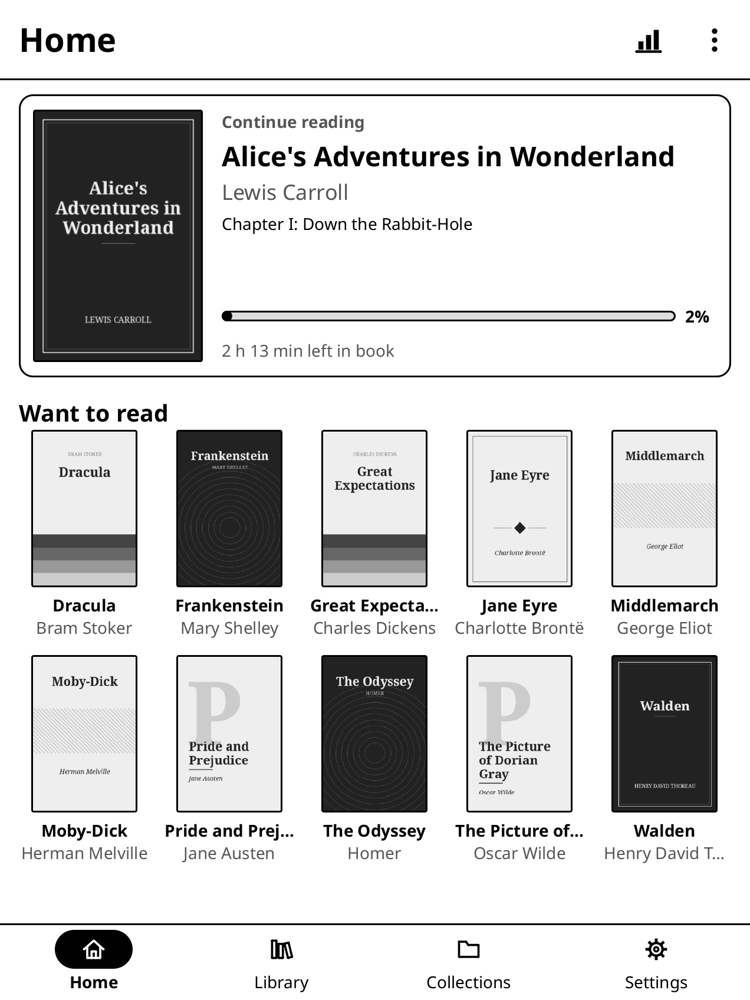
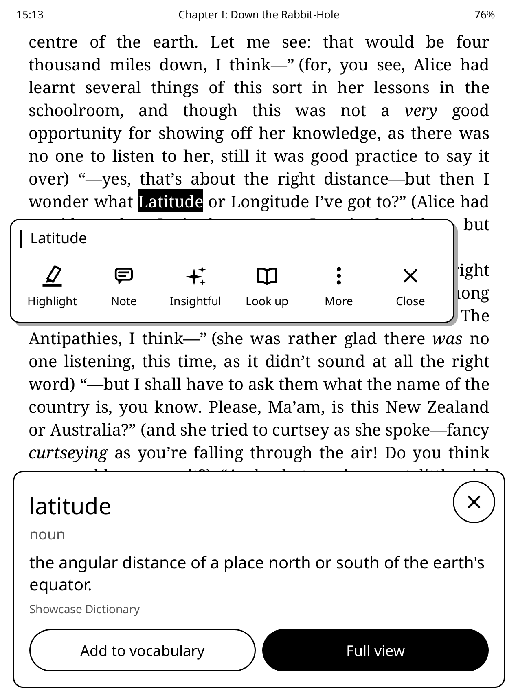
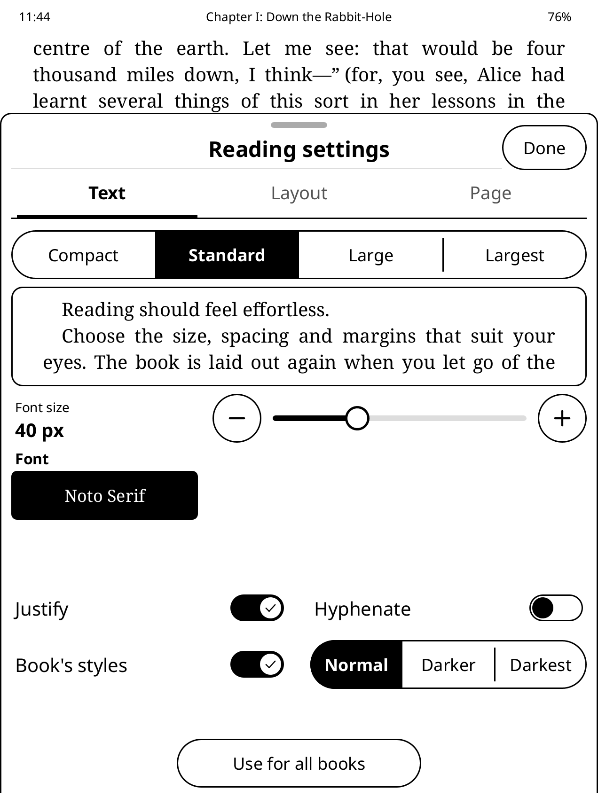
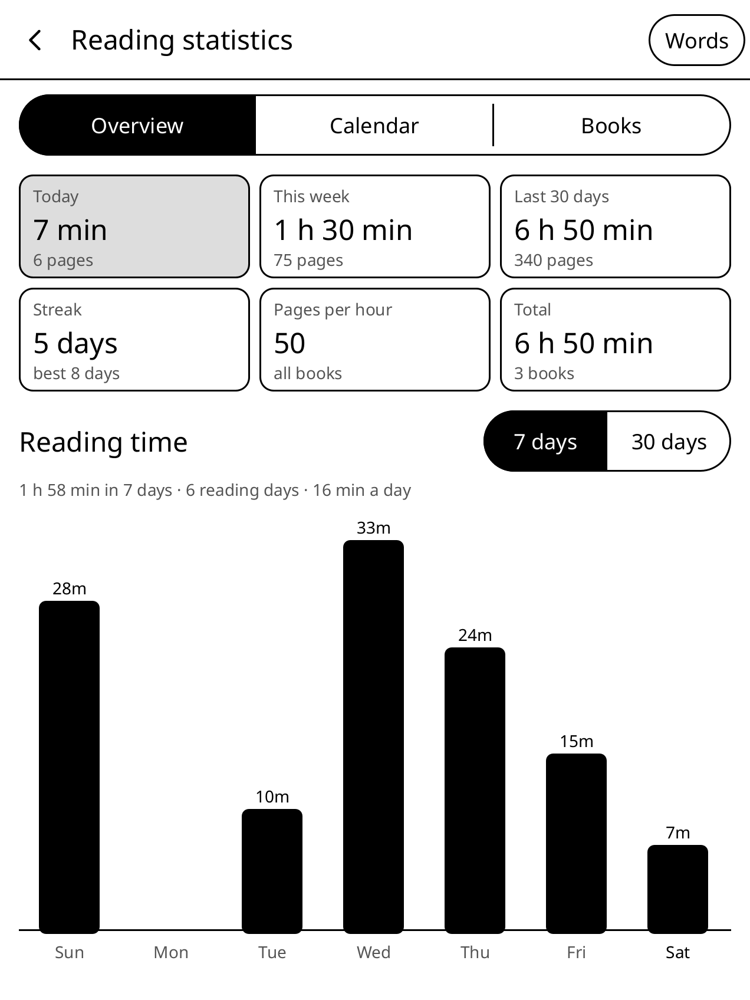
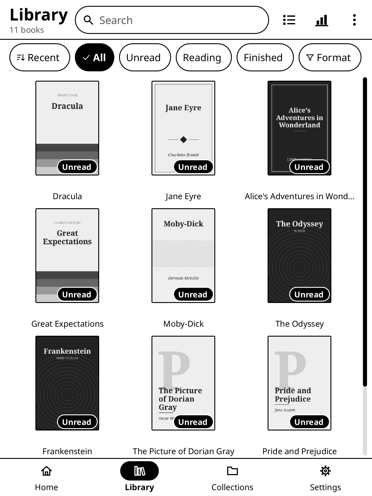
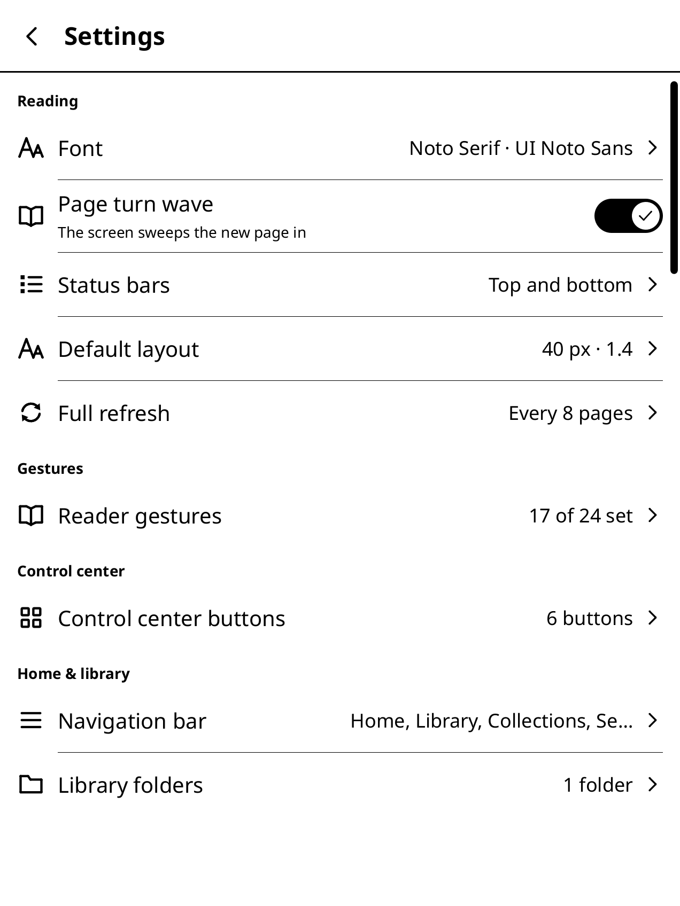

<p align="center">
  <picture>
    <source media="(prefers-color-scheme: dark)" srcset="docs/logo/halftone-header-dark.svg">
    
  </picture>
</p>

<p align="center">
  An e-book reader for Kindle and Kobo e-readers, written in Rust.
</p>

<p align="center">
  <a href="../../releases/latest">Download</a> ·
  <a href="#install">Install</a> ·
  <a href="docs/user-guide.md">User guide</a> ·
  <a href="docs/kobo.md">Kobo</a> ·
  <a href="docs/plugins.md">Plugins</a>
</p>

<table>
  <tr>
    <td></td>
    <td></td>
    <td></td>
  </tr>
  <tr>
    <td align="center"><sub>Home</sub></td>
    <td align="center"><sub>Reading</sub></td>
    <td align="center"><sub>Dictionary</sub></td>
  </tr>
  <tr>
    <td></td>
    <td></td>
    <td></td>
  </tr>
  <tr>
    <td align="center"><sub>Reading settings</sub></td>
    <td align="center"><sub>Highlights and notes</sub></td>
    <td align="center"><sub>Statistics</sub></td>
  </tr>
</table>

rinky replaces the Kindle's reading screens while it runs and gives the Kindle back when
you exit. It is a single static binary that draws directly to the e-ink display and reads
the touchscreen from the kernel.

## Features

- Formats: EPUB, MOBI and AZW3 without DRM, FB2, TXT, HTML, PDF and CBZ.
- Justified text with hyphenation; font, size, spacing, margins and weight are adjustable.
  Any font copied to the Kindle can be used, including the built-in Bookerly.
- Dictionary lookup (StarDict), Wikipedia, and an optional AI assistant that uses your
  own API key.
- Highlights, notes and bookmarks, exportable as Markdown. Reading statistics and a
  vocabulary list.
- Calibre wireless transfers, OPDS catalogs, KOReader sync, and import of KOReader
  positions and highlights.
- Plugins in Lua or Rust.

rinky never modifies the Kindle's own library or KOReader's files.

<table>
  <tr>
    <td></td>
    <td></td>
    <td></td>
  </tr>
</table>

## Performance

rinky is written in Rust, from the touch input to the pixels on the screen (PDFs and
comics are drawn by MuPDF). Rust programs run as fast, compact native code, so the
reader stays quick on the Kindle's modest processor and memory: books open fast, page
turns don't stall, and long books are paginated in the background while you start
reading.

## Install

rinky runs on Kindles (jailbroken, with KUAL) and Kobos (with NickelMenu) that have a
300 ppi screen. The [install guide](docs/install.md) lists every model and walks through
each step; in short:

| | Kindle | Kobo |
|---|---|---|
| Prepare | jailbreak and KUAL ([kindlemodding.org](https://kindlemodding.org/)) | [NickelMenu](https://pgaskin.net/NickelMenu/) (no jailbreak) |
| Download | `rinky-<version>-kindle.zip` | `rinky-<version>-kobo.zip` |
| Copy over USB | `rinky` and `extensions` to the top of the Kindle drive | `.adds` to the top of the Kobo drive (hidden folder) |
| Start | KUAL › rinky › Start rinky | NickelMenu › rinky |

Downloads are on the [latest release](../../releases/latest). **Settings › Update** in
rinky installs newer versions over Wi-Fi, keeping settings, notes and positions.
**Settings › Exit to Kindle** (or *to Kobo*) returns to the e-reader's own screens.

Dictionaries go in rinky's folder under `dict/<name>/`, as StarDict files (`.ifo`,
`.idx`, `.dict` or `.dict.dz`). If you try rinky on a model marked untested, please
open an issue with `rinky.log` from rinky's folder, whether it worked or not.

The [user guide](docs/user-guide.md) covers everything else, including troubleshooting.

## Build from source

```sh
rustup target add armv7-unknown-linux-musleabihf
brew install zig            # or your package manager; zig 0.17
cargo install cargo-zigbuild
scripts/package.sh          # → out/package/rinky-<version>-kindle{hf.tar.gz,.zip}
```

The result is a static ARMv7 binary plus the launcher, watchdog and KUAL menu. Try the
reader on your computer without a Kindle:

```sh
cargo run --release -p ink-app -- sim path/to/books/   # simulator window
cargo test --workspace
```

Pushing a tag `vX.Y.Z` that matches the version in `Cargo.toml` builds and publishes a
release with GitHub Actions ([`.github/workflows/release.yml`](.github/workflows/release.yml)).
Screenshots are regenerated with `scripts/screenshots.sh`. The code is laid out in
[`docs/ARCHITECTURE.md`](docs/ARCHITECTURE.md); testing is described in
[`docs/TESTING.md`](docs/TESTING.md).

## License

rinky is licensed under the [GNU AGPL v3 or later](LICENSE) because its PDF engine,
[MuPDF](https://mupdf.com/), is AGPL. The bundled Noto Serif and Noto Sans fonts
are under the SIL Open Font License ([`fonts/LICENSE-Noto`](fonts/LICENSE-Noto)).
The books in the screenshots are public domain; their covers are generated
(`scripts/make-showcase-library.py`).
